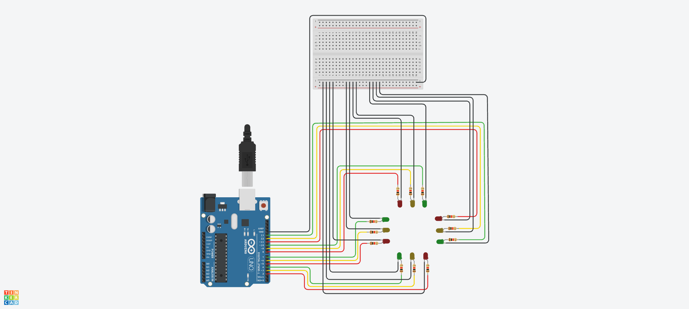

# Four-Way Traffic Light Controller

An Arduino Uno-based four-way traffic light controller built with **12 LEDs**. The project simulates a four-road intersection by giving each road a timed green signal in sequence while the other three roads remain red.

## Project Preview

## Features

- Controls four roads using 12 LEDs.
- Each road has red, yellow, and green signal LEDs.
- Runs a startup light test before normal operation.
- Gives each road a 10-second green phase.
- Turns the yellow LEDs of the outgoing and next road on together for a 2-second transition.
- Repeats the four-road sequence continuously.

## Components Required

- Arduino Uno
- 12 LEDs:
  - 4 red
  - 4 yellow
  - 4 green
- 12 current-limiting resistors (typically 220 Ω to 330 Ω, one per LED)
- Breadboard
- Jumper wires
- USB cable

## Pin Connections

| Road | Red LED | Yellow LED | Green LED |
|---|---:|---:|---:|
| Road 1 | 2 | 3 | 4 |
| Road 2 | 5 | 6 | 7 |
| Road 3 | 8 | 9 | 10 |
| Road 4 | 11 | 12 | 13 |

Each LED must have its own series current-limiting resistor. Connect each LED's anode through its resistor to the assigned Arduino digital pin and its cathode to GND. Check LED polarity before powering the circuit.

## Startup Sequence

When the Arduino is powered on, the project runs this LED test:

1. All 12 LEDs turn on for 800 ms and turn off for 800 ms (one long blink).
2. All 12 LEDs blink twice, with 500 ms on and 500 ms off.
3. All four red LEDs blink once.
4. All four yellow LEDs blink once.
5. All four green LEDs blink once.
6. The normal traffic sequence starts.

## Traffic Signal Sequence

Each road receives a 10-second green signal. At each transition, the yellow LEDs for the road whose turn is ending and the next road turn on together for 2 seconds.

| Step | Road 1 | Road 2 | Road 3 | Road 4 | Duration |
|---|---|---|---|---|---:|
| 1 | Green | Red | Red | Red | 10 seconds |
| 2 | Yellow | Yellow | Red | Red | 2 seconds |
| 3 | Red | Green | Red | Red | 10 seconds |
| 4 | Red | Yellow | Yellow | Red | 2 seconds |
| 5 | Red | Red | Green | Red | 10 seconds |
| 6 | Red | Red | Yellow | Yellow | 2 seconds |
| 7 | Red | Red | Red | Green | 10 seconds |
| 8 | Yellow | Red | Red | Yellow | 2 seconds |

After Step 8, the cycle returns to Step 1 and repeats.

## Arduino Code

The complete Arduino sketch is available here:

**[TrafficLights.ino](TrafficLights.ino)**

### Upload Instructions

1. Install and open the Arduino IDE.
2. Open `TrafficLights.ino`.
3. Connect the Arduino Uno to your computer using a USB cable.
4. Select **Tools → Board → Arduino Uno**.
5. Select the correct port under **Tools → Port**.
6. Click **Upload**.
7. Once the upload finishes, power the circuit and observe the sequence.

## Concepts Demonstrated

- Arduino digital input/output pin configuration
- `pinMode()` and `digitalWrite()`
- Timing with `delay()`
- Sequential control of multiple LEDs
- Basic embedded-system logic

## Possible Improvements

- Add pedestrian crossing signals and push buttons.
- Add a buzzer for pedestrian alerts.
- Replace blocking `delay()` calls with a `millis()`-based timing system.
- Add vehicle sensors to adjust signal timing.

## Author

**Abhiram Dashewar**

- GitHub: [@Abhiram-Dashewar](https://github.com/Abhiram-Dashewar)

---

This is an educational prototype for learning Arduino and basic traffic-signal control. It is not designed or certified for controlling real-world road traffic.
